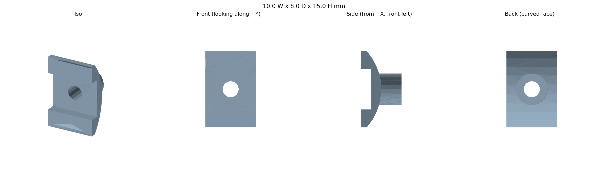

# Replacement insert generator

A parametric, 3D-printable replacement for a small insert that slides into a
curved housing: a stepped block with a hole through it and an optional tube
standing out of the curved back. Measure the original with calipers, put the
numbers in `params.json`, and print a replacement.

Generated with [CadQuery](https://github.com/CadQuery/cadquery).



## Parameters

`params.json` is split into groups:

- `measured`: the original's hand measurements. Running `generate.py` prints
  a labelled diagram (letters A to M) showing what each one is.
- `fit`: offsets to tweak the printed part without touching the
  measurements (hole clearance, edge fillet, curving the back face).
- `tube`: the cylinder that fills the hole and stands out of the back.
- `curve`: the housing curve radius, worked out from its chord width and
  depth, or set by hand.

All lengths are in mm.

## Generate

```bash
python -m pip install cadquery matplotlib
python generate.py                  # reads params.json
python generate.py other.json       # reads a different parameter file
python sweep.py                     # one variant per value of a swept parameter
```

`sweep.py` writes several variants side by side, so you can print them all
and test which fits best.

## License

[MIT](LICENSE)
